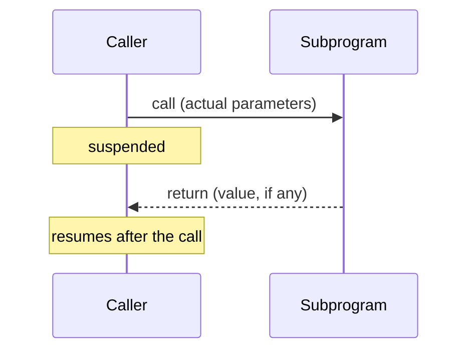
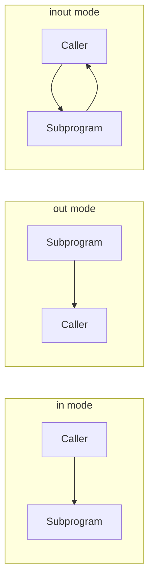
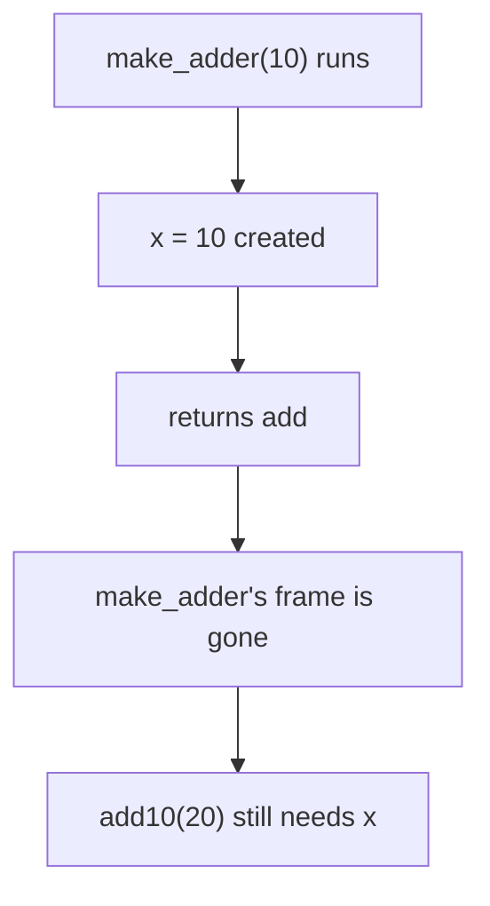
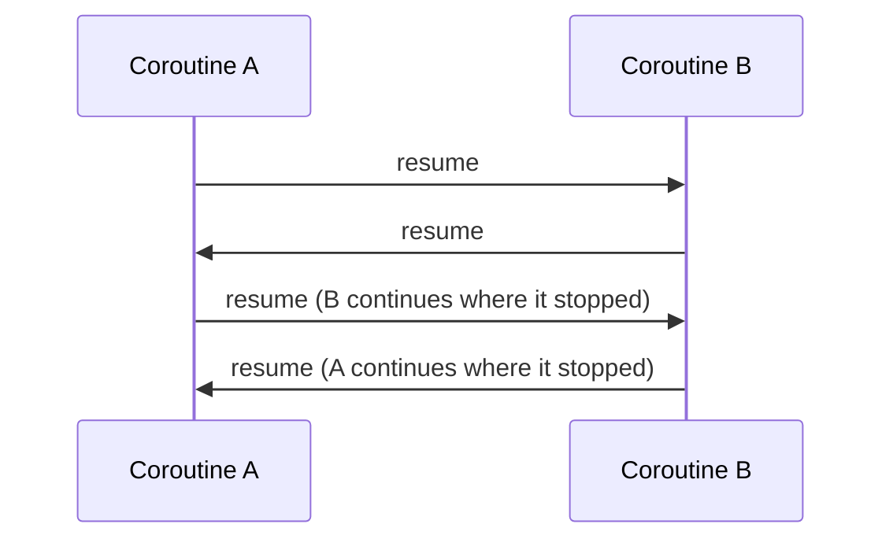

# Programming Languages
## Week 7 — Subprograms

Sebesta, Chapter 9

---

# Today

1. What a subprogram is — vocabulary
2. Parameters — positional, keyword, default, variable count
3. Local referencing environments
4. Parameter-passing methods — value, result, value-result, reference, name
5. Subprograms as parameters — shallow vs deep binding
6. Calling subprograms indirectly
7. Design issues for functions — side effects, return types, multiple returns
8. Overloaded and generic subprograms
9. Closures
10. Coroutines

---

# Where this fits

| Week | Focus |
| --- | --- |
| 4 | Names, bindings, static vs dynamic scope |
| 6 | Expressions and control |
| **7** | Subprograms — how calls, parameters, and returns are **designed** |
| 8 | Implementing subprograms — how calls **work** underneath |
| 9 | Midterm (Weeks 1–7) |
| Lab 3–4 | Your interpreter evaluates function definitions and calls |

---

# Section 9.1 — Two kinds of abstraction

| Abstraction | What it hides | Chapter |
| --- | --- | --- |
| **Process** abstraction | **How** a task is done | 9 — subprograms |
| **Data** abstraction | **How** data is stored | 11 — ADTs |

```python
sorted_names = sorted(names)
```

You know **what** `sorted` does. You don't need to know **how**.

Subprograms are the oldest abstraction in programming — they were in the first assemblers.

---

# Section 9.2 — General characteristics

Nearly every language's subprograms share three properties:

1. Each subprogram has a **single entry point**
2. The **caller is suspended** while the subprogram runs
3. Control **returns to the caller** when the subprogram ends



Coroutines (end of today) break rule 2.

---

# Vocabulary

| Term | Meaning | Example |
| --- | --- | --- |
| **Definition** | Interface + actions | The whole `def` block |
| **Header** | First line: kind, name, parameters | `def area(w, h):` |
| **Call** | Request to run it | `area(3, 4)` |
| **Parameter profile** | Number, order, types of parameters | `(int, int)` |
| **Protocol** | Parameter profile + return type | `(int, int) → int` |
| **Declaration / prototype** | Protocol without a body | C: `int area(int w, int h);` |

| Kind | Returns a value? | Example |
| --- | --- | --- |
| **Procedure** | No — works by side effect | Ada `procedure`, Java `void` method |
| **Function** | Yes | Most C-based and Python functions |

---

# Formal vs actual parameters

```python
def area(width, height):     # formal parameters
    return width * height

area(3, 4)                   # actual parameters (arguments)
```

| Formal | Actual |
| --- | --- |
| In the **header** | In the **call** |
| A name — bound only during the call | A value or expression |

The **binding** of actuals to formals is what parameter passing is all about.

---

# Positional vs keyword parameters

**Positional:** first actual → first formal, second → second.

**Keyword:** name the formal in the call.

```python
def compute_pay(income, exemptions=1, tax_rate=0.10):
    ...

compute_pay(20000.0, tax_rate=0.15)
```

| Approach | Pro | Con |
| --- | --- | --- |
| Positional | Short | Must remember order |
| Keyword | Any order, readable | Must know formal names; renaming a parameter breaks callers |

| Language | Keyword parameters |
| --- | --- |
| Python, Ada, C#, Kotlin, Swift | Yes |
| C, C++, Java | No — positional only |

---

# Default values and variable counts

**Default values** — a formal can be omitted in the call:

| Language | Example |
| --- | --- |
| Python, C++, C#, Kotlin | `def f(x, n=10)` |
| Java | No defaults — use overloading |

**Variable number of parameters:**

| Language | Syntax |
| --- | --- |
| C | `int printf(const char *fmt, ...)` |
| Java | `int sum(int... nums)` |
| C# | `int Sum(params int[] nums)` |
| Python | `def mean(*values)` and `**options` for keywords |
| Ruby, Lua, JS | `*args`, `...`, `...args` |

```python
def mean(*values):
    return sum(values) / len(values)

mean(3, 4, 5)     # values = (3, 4, 5)
```

---

# Section 9.3 — Design issues for subprograms

| Question | Covered |
| --- | --- |
| Are local variables static or stack-dynamic? | Section 9.4 |
| Can subprograms be **nested**? | Section 9.4 |
| Which **parameter-passing** methods? | Section 9.5 |
| Are parameter **types checked**? | Section 9.5 |
| Can subprograms be passed as parameters? What environment do they use? | Section 9.6 |
| Are functional **side effects** allowed? What can be **returned**? | Section 9.8 |
| Can subprograms be **overloaded** or **generic**? | Section 9.9-9.10 |
| Are **closures** supported? | Section 9.12 |

---

# Section 9.4 — Local variables

| Kind | Lifetime | Pros | Cons |
| --- | --- | --- | --- |
| **Stack-dynamic** | One call | Recursion works; memory shared across calls | Allocation cost each call; no memory between calls |
| **Static** | Whole program | Fast; remembers values between calls | No recursion |

Most languages default to stack-dynamic. C lets you opt in to static:

```c
int next_id(void) {
    static int count = 0;    /* initialized once, kept between calls */
    count++;
    return count;
}
```

Week 8 shows how stack-dynamic locals live in **activation records**.

---

# Python — locals, `global`, `nonlocal`

Assigning to a name inside a function makes it **local** — unless you say otherwise.

```python
day = "Monday"

def tester():
    global day
    print("The global day is:", day)
    day = "Tuesday"

tester()
print(day)          # Tuesday
```

`nonlocal` does the same for a variable in an **enclosing function** (closures, later today).

---

# Nested subprograms

Defining a subprogram **inside** another one.

| Allowed | Not allowed |
| --- | --- |
| ALGOL 60, Pascal, Ada, Python, JavaScript, Ruby, Swift, Kotlin, functional languages | C, C++ (lambdas only), Java (lambdas and inner classes only) |

```python
def outer(data):
    def helper(x):
        return x * 2
    return [helper(d) for d in data]
```

Nesting + static scope → the inner function can see the outer function's locals (Week 4).

---

# Section 9.5 — Parameter passing: semantic models

What **direction** does data flow?



| Mode | Meaning | Ada keyword |
| --- | --- | --- |
| **in** | Formal receives data from the actual | `in` |
| **out** | Formal sends data back to the actual | `out` |
| **inout** | Both | `in out` |

---

# Implementation models

How a language **delivers** those semantics:

| Method | Mode | How |
| --- | --- | --- |
| **Pass-by-value** | in | Copy the actual's **value** into the formal |
| **Pass-by-result** | out | At return, copy the formal's value **back** to the actual |
| **Pass-by-value-result** | inout | Copy in at call, copy back at return |
| **Pass-by-reference** | inout | Pass an **access path** (address); formal and actual are the **same** variable |
| **Pass-by-name** | inout | Substitute the actual's **text** — re-evaluated at every use |

---

# Pass-by-value

```c
void swap(int a, int b) {
    int temp = a;
    a = b;
    b = temp;
}

int x = 1, y = 2;
swap(x, y);     /* x == 1, y == 2 — nothing happened */
```

| Pro | Con |
| --- | --- |
| Caller's variable is safe | Copying large values costs time and space |
| Simple to reason about | No way to send results back (except the return value) |

---

# Pass-by-reference

```cpp
void swap(int& a, int& b) {
    int temp = a;
    a = b;
    b = temp;
}

int x = 1, y = 2;
swap(x, y);     // x == 2, y == 1
```

| Pro | Con |
| --- | --- |
| No copying — fast for large data | Caller's variables can change unexpectedly |
| Two-way communication | Creates **aliases** |

C has no reference parameters — it fakes them by passing pointers: `swap(&x, &y)`.

---

# The aliasing problem

```cpp
void fun(int& first, int& second) {
    first = first + 1;
    second = second * 2;
}

int total = 5;
fun(total, total);     // first and second are both total
```

Inside `fun`, `first` and `second` are **two names for one variable**.

| Step | `total` |
| --- | --- |
| start | 5 |
| `first = first + 1` | 6 |
| `second = second * 2` | 12 |

Also happens with `fun(list[i], list[j])` when `i == j`.

---

# Pass-by-result

Formal starts **uninitialized**. Its value is copied to the actual at return.

C# `out` parameters:

```csharp
void Fixer(out int x, out int y) {
    x = 17;
    y = 35;
}

f.Fixer(out a, out a);    // is a 17 or 35?
```

| Problem | |
| --- | --- |
| Actual-parameter **collision** | Both copy back to `a` — the order decides the answer |
| **When** is the address of the actual computed? | `sub(list[i])` — at the call or at the return, if `i` changed? |

---

# Pass-by-value-result

Copy in at the call, copy back at the return — sometimes called **pass-by-copy**.

Same effect as reference **most** of the time, but the formal is a separate local copy.

Shares the problems of both:

- Copying cost (like pass-by-value)
- Order-of-copy-back collisions (like pass-by-result)

Used by Fortran implementations and Ada `in out` for scalar types.

---

# Pass-by-name

The actual is substituted **textually** for the formal and **re-evaluated** every time the formal is used.

```text
int i;
int arr[3] = {10, 20, 30};

procedure show(name x)
    i = 0;  print x;     -- x means arr[i] → arr[0] → 10
    i = 2;  print x;     -- x means arr[i] → arr[2] → 30

show(arr[i]);
```

| Where it lives | |
| --- | --- |
| ALGOL 60 | The original — confusing and slow, dropped by successors |
| Scala | By-name parameters: `def log(msg: => String)` |
| Haskell | Lazy evaluation is a cousin — arguments evaluated only when needed |

---

# Same call, five models

```text
procedure sub(x, y)
    x = x + 1
    y = y * 2

a = 5
sub(a, a)
print a
```

| Method | Printed `a` | Why |
| --- | --- | --- |
| Value | 5 | Only copies change |
| Reference | 12 | `x`, `y`, `a` are one variable: 5 → 6 → 12 |
| Value-result | 10 **or** 6 | Copies end as `x = 6`, `y = 10`; whichever copies back **last** wins |
| Name | 12 | `x` and `y` both mean `a` |
| Result | — | `x` starts uninitialized, so `x + 1` is meaningless |

---

# Parameter passing in real languages

| Language | Method |
| --- | --- |
| C | Value only; pointers give reference-like behavior |
| C++ | Value, plus reference (`int&`) and `const int&` (fast, read-only) |
| Java | Value — but object variables **hold references**, so the reference is copied |
| C# | Value by default; `ref` (reference), `out` (result-like) |
| Ada | `in`, `out`, `in out` — the compiler picks copy or reference |
| Python, Ruby | **Pass-by-assignment** — the formal is bound to the same object |
| Swift | Value; `inout` with `&` at the call |
| Rust | Move (ownership), `&` (borrow), `&mut` (mutable borrow) |

---

# Python — pass-by-assignment

The formal is **another name for the same object**. What happens next depends on mutability.

```python
def add_item(lst):
    lst.append(99)        # mutates the shared object

def replace(lst):
    lst = [0, 0, 0]       # rebinds the local name only

nums = [1, 2, 3]
add_item(nums)    # nums == [1, 2, 3, 99]
replace(nums)     # nums == [1, 2, 3, 99]  (unchanged)
```

| Operation inside the function | Caller sees it? |
| --- | --- |
| Mutate the object (`append`, `x[0] = …`) | **Yes** |
| Rebind the name (`lst = …`) | No |
| Any change to an `int`, `str`, `tuple` | No — they are immutable |

Java object parameters behave the same way.

---

# Type checking parameters

Should the compiler check that actuals match formals?

| Language | Checked? |
| --- | --- |
| Original C (K&R) | **No** — `sqrt(2)` passed an `int` where a `double` was expected |
| C89+ with prototypes, C++, Java, C#, Rust | Yes |
| Python, Ruby, JS | No static check — errors appear at run time (or never) |
| Python with type hints | Optional, checked by external tools (mypy) |

Unchecked parameters are a classic **reliability** problem.

---

# Design trade-offs

| Goal | Favors |
| --- | --- |
| Efficiency for large data | Reference |
| Safety — caller's data can't change | Value (one-way) |
| Both | `const` references (C++), `in` mode (Ada), immutability (Rust `&`) |

Ties back to Chapter 1: **reliability** vs **cost**.

---

# Section 9.6 — Subprograms as parameters

Pass a subprogram **as an argument**:

```python
def apply_twice(f, x):
    return f(f(x))

apply_twice(lambda n: n + 3, 10)     # 16
```

Two design questions:

1. Are the **parameters of the passed subprogram** type-checked?
2. Which **referencing environment** does the passed subprogram use when it runs?

---

# Which environment? — the setup

```javascript
function sub1() {
    var x;
    function sub2() { alert(x); }
    function sub3() { var x; x = 3; sub4(sub2); }
    function sub4(subx) { var x; x = 4; subx(); }
    x = 1;
    sub3();
}
```

`sub2` is **defined** inside `sub1`, **passed** by `sub3`, and **called** inside `sub4`. Which `x` does it print?

---

# Shallow, deep, and ad hoc binding

| Binding | Environment used | Prints |
| --- | --- | --- |
| **Shallow** | Where it is **called** (`sub4`) | 4 |
| **Deep** | Where it is **defined** (`sub1`) | 1 |
| **Ad hoc** | Where it was **passed** (`sub3`) | 3 |

| Rule of thumb | Languages |
| --- | --- |
| Static scope → **deep** binding | JavaScript, Python, Scheme, almost all modern languages |
| Dynamic scope → often **shallow** | Some older dynamically scoped languages |
| Ad hoc | Essentially never used |

Deep binding is the reason closures work.

---

# Section 9.7 — Calling subprograms indirectly

Store a subprogram in a variable, call it later. Used for callbacks, event handlers, and dispatch tables.

| Language | Mechanism |
| --- | --- |
| C, C++ | Function pointers: `int (*op)(int, int) = add;` |
| C# | **Delegates**: `Func<int, int, int> op = Add;` |
| Java | Functional interfaces + lambdas: `BinaryOperator<Integer> op = (a, b) -> a + b;` |
| Python, JS, Ruby | Functions are values — just assign them |

```python
ops = {"+": lambda a, b: a + b,
       "*": lambda a, b: a * b}

ops["*"](3, 4)     # 12
```

That dictionary is a tiny interpreter dispatch table.

---

# Section 9.8 — Design issues for functions

| Question | Options |
| --- | --- |
| Are **side effects** allowed? | Ada functions originally allowed only `in` parameters; most languages allow anything |
| What **types** can be returned? | Arrays? Records? Functions? |
| How **many** values can be returned? | One, or several |

Side effects in functions → Week 6 Part 1 evaluation-order problems (`a + fun(a)`).

---

# Return types and multiple returns

| Language | Can return | Multiple values |
| --- | --- | --- |
| C | Anything except arrays and functions (pointers to them are fine) | No — use pointers or a struct |
| C++ | Any type, including objects | `std::pair`, `std::tuple` |
| Java, C# | Any type (Java: methods aren't types, but lambdas are) | Return an object |
| Python, Ruby | Anything — including functions and classes | Tuple / array: `return lo, hi` |
| Go | Any type | Built in: `func divmod(a, b int) (int, int)` |
| Lua | Any type | Built in: `return a, b` |
| ML, F#, Rust | Any type | Tuples |

```python
def min_max(values):
    return min(values), max(values)

lo, hi = min_max([4, 9, 1])
```

---

# Section 9.9 — Overloaded subprograms

Same name, different **parameter profile**:

```java
static int area(int side)                { return side * side; }
static int area(int width, int height)   { return width * height; }
static double area(double radius)        { return Math.PI * radius * radius; }
```

The compiler picks the version from the **actual parameters**.

| Language | Overloading |
| --- | --- |
| C++, Java, C#, Kotlin, Swift | Yes, by parameter profile |
| Ada | Yes — even by **return type** alone |
| C, Python, Go | No — Python keeps the **last** `def` with that name |

---

# Overloading pitfalls

**Ambiguity with default parameters (C++):**

```cpp
void fun(float b = 0.0);
void fun();

fun();      // compile error: which one?
```

**Ambiguity with coercion:**

```cpp
void show(long x)   { ... }
void show(double x) { ... }

show(5);    // int → long or int → double?
```

| Language | Result |
| --- | --- |
| C++ | Compile error — both conversions rank the same |
| Java | Picks `long` — the "most specific" rule |

More overloading → more rules the reader must know.

---

# Section 9.10 — Generic subprograms

**Polymorphism** — one subprogram, many types.

| Kind | Mechanism | Example |
| --- | --- | --- |
| **Ad hoc** | Overloading | `area(int)`, `area(double)` |
| **Subtype** | A parameter of type `T` accepts any subclass of `T` | Week 11 OOP |
| **Parametric** | A **type parameter** | `max<T>(T a, T b)` |

Parametric polymorphism = **generic** subprograms.

---

# C++ templates

```cpp
template <typename T>
T max_of(T first, T second) {
    return first > second ? first : second;
}

max_of(3, 7);         // T = int
max_of(2.5, 1.5);     // T = double
```

- The compiler builds a **separate copy** for each type used
- Works for any `T` that supports `>`
- Errors show up only when a bad type is used — often with huge error messages

---

# Java and C# generics

```java
public static <T extends Comparable<T>> T maxOf(T a, T b) {
    return a.compareTo(b) > 0 ? a : b;
}
```

| | C++ templates | Java generics | C# generics |
| --- | --- | --- | --- |
| Copies of the code | One per type | **One** (type erasure) | One per value type, shared for reference types |
| Primitive types? | Yes | No — `Integer`, not `int` | Yes |
| Constraints | Implicit (does `>` compile?) | `extends` bound | `where T : IComparable<T>` |
| Type info at run time | — | Erased | Kept |

---

# Generics in other languages

| Language | Approach |
| --- | --- |
| Python, Ruby, JS | **Duck typing** — every function is already "generic"; errors at run time |
| Rust | Generics + **trait bounds**: `fn max_of<T: PartialOrd>(a: T, b: T) -> T` |
| ML, F#, Haskell | **Type inference** finds the most general type automatically |
| Go 1.18+ | Type parameters: `func Max[T constraints.Ordered](a, b T) T` |

```fsharp
let pair x y = (x, y)     // inferred: 'a -> 'b -> 'a * 'b
```

---

# Section 9.11 — User-defined overloaded operators

Covered in Week 6 Part 1:

| Language | Define `+` for your type |
| --- | --- |
| C++ | `Vec operator+(const Vec& a, const Vec& b)` |
| Python | `def __add__(self, other)` |
| Ruby | `def +(other)` |
| C#, Kotlin, Swift | Yes |
| Java | No |

An operator is just a subprogram with special call syntax.

---

# Section 9.12 — Closures

A **closure** = a subprogram **plus** the referencing environment where it was **defined**.

```python
def make_adder(x):
    def add(y):
        return x + y
    return add

add10 = make_adder(10)
add5 = make_adder(5)

add10(20)    # 30
add5(20)     # 25
```

`make_adder` has **returned**, yet `add10` still uses its `x`.

---

# Why closures need special support



- Normally a local lives on the stack and dies at return
- A closure's captured variables need **unlimited extent** — they must live on the **heap**
- Needed only when nested subprograms can be **returned** or **stored**, and the language has static scope

---

# Closures across languages

| Language | Example |
| --- | --- |
| JavaScript | `function makeAdder(x) { return function (y) { return x + y; }; }` |
| Python | `lambda y: x + y` inside a function |
| C# | `Func<int, int> add = y => x + y;` |
| Java 8+ | `y -> x + y` — captured `x` must be **effectively final** |
| C++11 | `[x](int y) { return x + y; }` — choose capture by value or reference |
| Ruby | blocks and `lambda { \|y\| x + y }` |
| Scheme, ML, Haskell | Everywhere — functions are values |

---

# Closures with state

```python
def make_counter():
    count = 0
    def increment():
        nonlocal count
        count += 1
        return count
    return increment

c1 = make_counter()
c2 = make_counter()
c1(); c1()
c1()       # 3
c2()       # 1 — separate environment
```

Each call to `make_counter` creates a **new** environment. That's an object with one method — Week 10 makes the connection.

---

# Closure gotcha — late binding

```python
funcs = [lambda: i for i in range(3)]
[f() for f in funcs]       # [2, 2, 2] — not [0, 1, 2]
```

All three closures capture the **same variable** `i`, not its value at the time.

```python
funcs = [lambda i=i: i for i in range(3)]
[f() for f in funcs]       # [0, 1, 2]
```

The default parameter is evaluated **once, at definition** — a copy.

JavaScript had the same bug with `var` in loops; `let` fixed it by creating a new binding each iteration.

---

# Section 9.13 — Coroutines

A **coroutine** has **multiple entry points** and keeps its state between activations.

| Subprogram | Coroutine |
| --- | --- |
| Caller and callee — a master/slave relationship | **Equals** — each one resumes the other |
| Starts at the top every call | Resumes where it last stopped |
| Locals die at return | Locals survive between resumes |

Called **symmetric unit control**. Execution is interleaved — **quasi-concurrent**, but only one runs at a time.

---

# Coroutines — control flow



Classic uses: producer/consumer, simulations, games, parsers that pause for more input.

---

# Coroutines in practice

Lua has full coroutines:

```lua
co = coroutine.create(function ()
    for i = 1, 3 do
        print("co", i)
        coroutine.yield()
    end
end)

coroutine.resume(co)    -- co 1
print("main")
coroutine.resume(co)    -- co 2
```

Python generators are **semi-coroutines** — they yield only back to their caller:

```python
def averager():
    total, count, avg = 0, 0, None
    while True:
        value = yield avg
        total += value
        count += 1
        avg = total / count

a = averager()
next(a)          # run to the first yield
a.send(10)       # 10.0
a.send(20)       # 15.0
```

---

# Coroutine descendants

| Language | Feature |
| --- | --- |
| Lua, Simula 67, Modula-2 | Full coroutines |
| Python, JavaScript, C# | Generators (`yield`) and `async` / `await` |
| Kotlin | `suspend` functions |
| Go | Goroutines — scheduled concurrently, a step beyond coroutines |
| Erlang | Lightweight processes (Week 11) |

`async` / `await` is coroutines dressed up for network code: pause while waiting, let something else run.

---

# Quick map

| Topic | One-line takeaway |
| --- | --- |
| Formal vs actual | Header names vs call arguments |
| Keyword / default / variadic | Flexibility in how calls are written |
| Static vs stack-dynamic locals | Memory between calls vs recursion |
| Value | Copy in — safe, can be costly |
| Reference | Share the variable — fast, creates aliases |
| Value-result / result | Copy back at return — order collisions |
| Name | Re-evaluate the argument at every use |
| Deep vs shallow binding | Environment where defined vs where called |
| Overloading | Same name, different parameter profile |
| Generics | One definition, many types |
| Closure | Function + the environment it was defined in |
| Coroutine | Resumes where it left off; equals, not caller/callee |

---

# Tie-back to Labs 3 and 4

A function call in your evaluator is where this whole chapter becomes code.

| Design choice | Pick one and document it |
| --- | --- |
| Parameter passing | Value? (Easiest: evaluate the argument, bind the result) |
| Argument order | Left to right? |
| Wrong number of arguments | Run-time error message? |
| Environment for the body | Where the function was **defined** (static) or **called** (dynamic)? |
| Recursion | Does each call get fresh locals? |
| Return | `return` statement, or value of the last expression? |
| Functions as values | Can you pass or return a function? (closures — stretch) |

---

# A call in an evaluator

```python
class Closure:
    def __init__(self, params, body, def_env):
        self.params = params
        self.body = body
        self.def_env = def_env          # environment where it was defined

def eval_call(node, env):
    func = env.lookup(node.name)
    args = [eval_expr(a, env) for a in node.args]    # pass-by-value, left to right

    if len(args) != len(func.params):
        raise RuntimeError(f"{node.name} expects {len(func.params)} arguments")

    call_env = Environment(parent=func.def_env)      # static scope + deep binding
    for name, value in zip(func.params, args):
        call_env.define(name, value)

    return exec_body(func.body, call_env)
```

Change `parent=func.def_env` to `parent=env` and your language has **dynamic scope** (Week 4).

---

# Week 7 wrap

You should be able to:

- Use the vocabulary: header, protocol, formal, actual, procedure, function
- Explain positional, keyword, default, and variable-length parameters
- Trace a call under pass-by-value, reference, value-result, and name
- Spot aliasing caused by pass-by-reference
- Explain shallow vs deep binding for subprograms passed as parameters
- Compare overloading with generics; C++ templates with Java generics
- Write a closure and explain why its variables can't live on the stack
- Explain how a coroutine differs from an ordinary subprogram

---

# Before next week

**Read (if not done):** finish Chapter 9

**Next (Week 8):** Chapter 10 — how subprograms are implemented (activation records)

**Midterm (Week 9):** covers Weeks 1–7 (Chapters 1, 3–9); review sheet released Week 8

---

# Quick check prompts

1. In Python, `def f(a, b=2, *rest)`. What are `a`, `b`, and `rest` for `f(1)`? For `f(1, 5, 7, 9)`?
2. Trace `fun(x, x)` with `x = 1`, where `fun(a, b)` does `a = a + 1; b = b + a;`. What is `x` under pass-by-value? Reference? Value-result (copy back left to right)?
3. A Java method receives an `ArrayList` and calls `list.clear()`. Does the caller see it? What if the method does `list = new ArrayList<>()` instead?
4. In the `sub1`/`sub2`/`sub3`/`sub4` example, which binding does Python use? Why?
5. Why can't C++ overload two functions that differ only in return type?
6. What does `make_adder(3)(4)` return? What has to stay alive after `make_adder` returns?
7. Fix `[lambda: i for i in range(3)]` so the functions return `0`, `1`, `2`.
8. In your Lab 4 language, does a function body see the caller's variables? Which line of your evaluator decides that?
