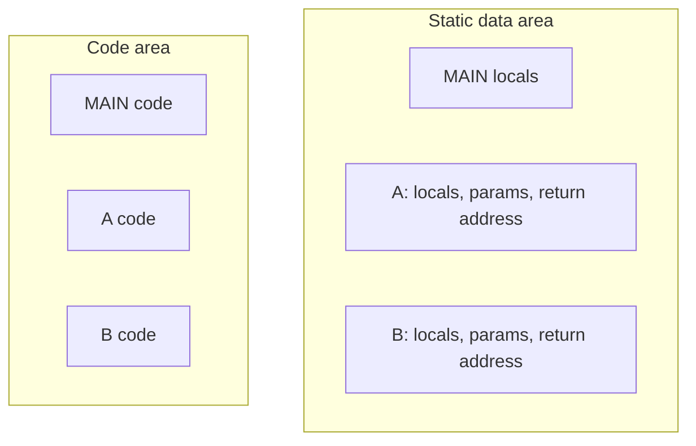
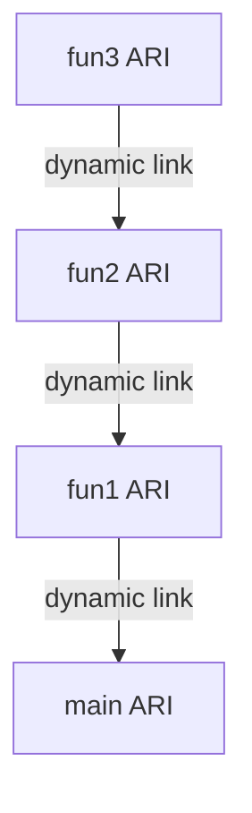
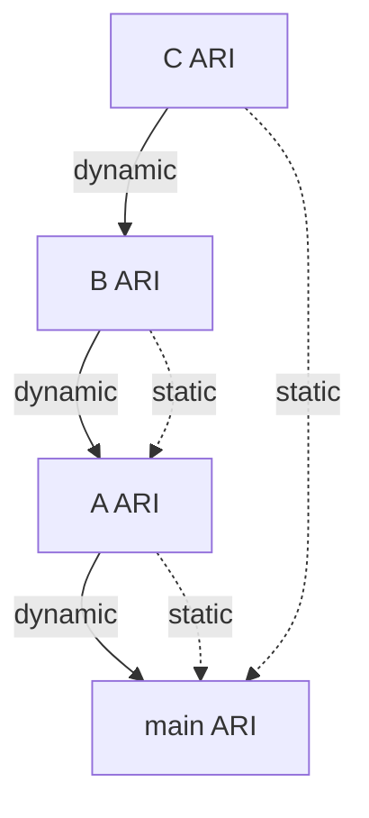
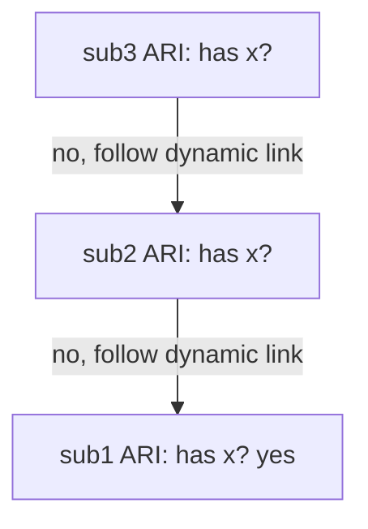

# Programming Languages
## Week 8 — Implementing Subprograms

Sebesta, Chapter 10

---

# Today

1. What every call and return must do
2. Simple subprograms — no recursion, static locals
3. Stack-dynamic locals — activation records and the run-time stack
4. Recursion on the stack
5. Nested subprograms — static links and static chains
6. Blocks
7. Implementing dynamic scoping — deep and shallow access
8. What this means for your interpreter

---

# Where this fits

| Week | Focus |
| --- | --- |
| 4 | Scope and lifetime — the **rules** |
| 7 | Subprograms — the **design** choices |
| **8** | Implementing subprograms — the **machinery** underneath |
| 9 | Midterm (Weeks 1–7); Lab 3 due |
| Lab 3–4 | Your environments and calls are this chapter in code |

Week 7 asked *what* a call means. Today asks *how* a computer makes it happen.

---

# Section 10.1 — Subprogram linkage

**Subprogram linkage** = the call and return operations together.

Every call has to answer:

| Question | Example |
| --- | --- |
| How are parameters passed? | Copy values? Pass addresses? |
| Where do locals live? | Static memory? A stack? |
| How does the caller resume? | Save its state and a return address |
| How are nonlocal variables found? | Only matters with nested subprograms |

---

# What a call does

| Call | Return |
| --- | --- |
| 1. Pass parameters | 1. Copy back out-mode / inout-mode parameters |
| 2. Allocate local variables | 2. Deliver the function's value, if any |
| 3. Save the caller's execution status | 3. Deallocate locals |
| 4. Arrange the return address | 4. Restore the caller's execution status |
| 5. Set up access to nonlocals (if nested) | 5. Jump back to the return address |
| 6. Jump to the subprogram's code | |

The rest of today is about **where** all that information is stored.

---

# Section 10.2 — "Simple" subprograms

The simplest case — old Fortran style:

- No recursion
- All locals are **static**
- No nested subprograms

Each subprogram has **two** parts:

| Part | Changes during a run? |
| --- | --- |
| **Code** | No — fixed instructions |
| **Activation record** | Yes — locals, parameters, return address |

---

# The activation record

An **activation record** is the layout of the non-code data a subprogram needs.

```text
┌──────────────────────┐
│ Functional value     │   (if it is a function)
├──────────────────────┤
│ Local variables      │
├──────────────────────┤
│ Parameters           │
├──────────────────────┤
│ Return address       │
└──────────────────────┘
```

An **activation record instance (ARI)** is one concrete copy of that layout for one call.

---

# Simple subprograms — static layout

No recursion means at most **one** activation of each subprogram at a time. So each one gets **one** ARI, allocated **before** the program runs.



Fast and simple. Recursion is impossible: a second call to `A` would overwrite the first one's data.

---

# Section 10.3 — Stack-dynamic local variables

Modern languages allow **recursion**, so the same subprogram can be active many times. Each activation needs its **own** locals.

Solution: create an ARI **at each call** and put it on the **run-time stack**.

```text
┌──────────────────────┐   ← top of the ARI
│ Local variables      │
├──────────────────────┤
│ Parameters           │
├──────────────────────┤
│ Dynamic link         │   → base of the caller's ARI
├──────────────────────┤
│ Return address       │
└──────────────────────┘   ← base of the ARI
```

| Field | Purpose |
| --- | --- |
| **Return address** | Where to continue in the caller |
| **Dynamic link** | Pointer to the **caller's** ARI — used to restore the stack on return |
| **Parameters** | Values or addresses from the caller |
| **Local variables** | This activation's own copies |

---

# An ARI for a real function

```c
void sub(float total, int part) {
    int list[5];
    float sum;
    ...
}
```

```text
┌──────────────────────┐
│ Local      sum       │
├──────────────────────┤
│ Local      list[4]   │
│            …         │
│ Local      list[0]   │
├──────────────────────┤
│ Parameter  part      │
├──────────────────────┤
│ Parameter  total     │
├──────────────────────┤
│ Dynamic link         │
├──────────────────────┤
│ Return address       │
└──────────────────────┘
```

The compiler knows this layout, so it knows each variable's **offset** from the base of the ARI.

---

# The environment pointer

The **environment pointer (EP)** points to the base of the **currently running** subprogram's ARI.

| Access | How |
| --- | --- |
| Local variable `sum` | Address = EP + offset of `sum` |
| Parameter `part` | Address = EP + offset of `part` |

| On call | On return |
| --- | --- |
| Save the old EP as the new ARI's **dynamic link** | Set EP back to the **dynamic link** |
| Set EP to the new ARI's base | Pop the ARI |

Offsets are fixed at **compile time**. Only EP changes at **run time**.

---

# Prologue and epilogue

The compiler adds small pieces of code around every call:

| Code | Where | Does |
| --- | --- | --- |
| **Prologue** | Start of the callee | Save the old EP as the dynamic link, set the new EP, allocate locals |
| **Epilogue** | End of the callee | Copy back out parameters, move the return value, restore EP, jump to the return address |

The caller handles its side: evaluating arguments and saving the return address.

---

# A call chain on the stack

```c
void fun3(int x) { ... }                  // point 3
void fun2(float r) { int s, t; fun3(s); }  // point 2 before the call
void fun1(float p) { float y; fun2(p); }   // point 1 before the call
void main() { float q; fun1(q); }
```

Stack at point 3 (grows upward):

```text
top →  ┌───────────────────────────────┐
       │ fun3   param x                │
       │        dynamic link ──► fun2  │
       │        return → fun2          │
       ├───────────────────────────────┤
       │ fun2   locals s, t; param r   │
       │        dynamic link ──► fun1  │
       │        return → fun1          │
       ├───────────────────────────────┤
       │ fun1   local y; param p       │
       │        dynamic link ──► main  │
       │        return → main          │
       ├───────────────────────────────┤
       │ main   local q                │
       └───────────────────────────────┘
```

---

# The dynamic chain

The dynamic links form the **dynamic chain** (or **call chain**): the history of calls that are still running.



You've seen it before — a **stack trace** is the dynamic chain printed out:

```python
def a(): b()
def b(): c()
def c(): raise RuntimeError("look at the stack")
a()
```

```text
Traceback (most recent call last):
  File "demo.py", line 4, in <module>
  File "demo.py", line 1, in a
  File "demo.py", line 2, in b
  File "demo.py", line 3, in c
RuntimeError: look at the stack
```

---

# Recursion on the stack

```c
int factorial(int n) {
    if (n <= 1)
        return 1;
    else
        return n * factorial(n - 1);
}

void main() {
    int value;
    value = factorial(3);
}
```

Every call gets a **new ARI** with its own `n`. A function's ARI also has a slot for its **return value**.

---

# Recursion — stack at the deepest point

```text
top →  ┌──────────────────────────────────┐
       │ factorial   n = 1                │
       │             return value: ?      │
       │             dynamic link ──► ↓   │
       │             return → factorial   │
       ├──────────────────────────────────┤
       │ factorial   n = 2                │
       │             return value: ?      │
       │             dynamic link ──► ↓   │
       │             return → factorial   │
       ├──────────────────────────────────┤
       │ factorial   n = 3                │
       │             return value: ?      │
       │             dynamic link ──► ↓   │
       │             return → main        │
       ├──────────────────────────────────┤
       │ main        value: ?             │
       └──────────────────────────────────┘
```

---

# Recursion — unwinding

| Step | ARI popped | Return value | Caller computes |
| --- | --- | --- | --- |
| 1 | `n = 1` | 1 | `2 * 1` |
| 2 | `n = 2` | 2 | `3 * 2` |
| 3 | `n = 3` | 6 | `value = 6` in `main` |

Too many ARIs = **stack overflow**.

| Language | What happens with runaway recursion |
| --- | --- |
| C, C++ | Crash (segmentation fault) |
| Java | `StackOverflowError` |
| Python | `RecursionError` after about 1000 frames (`sys.getrecursionlimit()`) |
| Scheme, many FP languages | **Tail calls** reuse the ARI — no growth for tail recursion |

---

# Section 10.4 — Nested subprograms

Languages with nested subprograms and static scope (JavaScript, Python, Ada, Swift, ML) need one more thing: a way to find **nonlocal** variables.

Two facts make it possible:

1. A nonlocal variable lives in some ARI **already on the stack**
2. The compiler knows **which** enclosing scope declares it

Finding the right ARI is the hard part.

---

# The static link

Add a **static link** to every ARI: a pointer to the ARI of its **static parent** (the subprogram it is defined inside).

```text
┌──────────────────────┐
│ Local variables      │
├──────────────────────┤
│ Parameters           │
├──────────────────────┤
│ Dynamic link         │   → caller's ARI          (who called me?)
├──────────────────────┤
│ Static link          │   → static parent's ARI   (where was I defined?)
├──────────────────────┤
│ Return address       │
└──────────────────────┘
```

The static links form the **static chain**.

---

# Static vs dynamic link — example

```javascript
function main() {             // depth 0
    var a = 1;
    function A() {            // depth 1
        var b = 2;
        function B() {        // depth 2
            var c = 3;
            C();
        }
        B();
    }
    function C() {            // depth 1
        print(a);
    }
    A();
}
```

Call order: `main → A → B → C`.

---

# Static vs dynamic link — the stack



| ARI | Dynamic link (caller) | Static link (definer) |
| --- | --- | --- |
| `C` | `B` | `main` |
| `B` | `A` | `A` |
| `A` | `main` | `main` |

To print `a`, `C` follows **one** static link to `main`. It never looks at `B` or `A`.

---

# Static depth and chain offset

**Static depth** = how deeply a scope is nested. `main` is 0.

A nonlocal reference compiles to a pair:

```text
(chain_offset, local_offset)
```

| Part | Meaning |
| --- | --- |
| **Chain offset** | How many static links to follow = depth of the reference − depth of the declaration |
| **Local offset** | Position of the variable inside that ARI |

From inside `B` (depth 2):

| Variable | Declared in (depth) | Chain offset |
| --- | --- | --- |
| `c` | `B` (2) | 0 — local |
| `b` | `A` (1) | 1 |
| `a` | `main` (0) | 2 |

Both numbers are known at **compile time**. No searching by name at run time.

---

# Setting the static link at a call

The caller has to find the callee's static parent's ARI.

| Situation | Static link |
| --- | --- |
| Callee is nested **directly inside** the caller | The caller's own ARI |
| Callee is a **sibling** or further out | Follow the caller's static chain `(caller depth − callee depth + 1)` links |

Example: `B` (depth 2) calls `C` (depth 1). Follow `2 − 1 + 1 = 2` links from `B`: `B → A → main`. So `C`'s static link is `main`. ✓

Again, the compiler computes the count. The run time just follows pointers.

---

# Static chain — trade-offs

| Pro | Con |
| --- | --- |
| Calls are cheap — set one extra pointer | Deeply nested references follow many links |
| Every reference is exact and known at compile time | Access time depends on nesting depth — hard for time-critical code |

In practice, nesting deeper than 2–3 levels is rare, so the chains are short.

An alternative — a **display** (an array with one pointer per depth) — makes every access one step but costs more at each call.

---

# Section 10.5 — Blocks

A **block** is a scope inside a subprogram:

```c
void main() {
    int x, y, z;
    while (...) {
        int a, b, c;
        ...
        while (...) {
            int d, e;
            ...
        }
    }
    while (...) {
        int f, g;
        ...
    }
}
```

Two ways to implement blocks:

| Approach | How |
| --- | --- |
| Treat a block as a **parameterless subprogram** | Push an ARI on entry, pop on exit, use static links |
| Allocate block variables **inside the enclosing ARI** | The compiler knows every block's size in advance |

---

# Blocks — sharing space

The second approach is more efficient. Blocks that are never active at the same time can **share** storage:

```text
main's ARI
┌───────────────┐
│ d   or  —     │
│ e   or  —     │
│ c   or  —     │
│ b   or  g     │
│ a   or  f     │
│ z             │
│ y             │
│ x             │
└───────────────┘
```

`f` and `g` reuse the slots of `a` and `b` because the first `while` has finished before the second one starts.

No pointers to follow, no extra pushes — just offsets.

---

# Section 10.6 — Implementing dynamic scoping

Week 4: with dynamic scope, a nonlocal name refers to the **most recent** active declaration in the **call chain**.

Two implementations:

| Method | Idea |
| --- | --- |
| **Deep access** | Search the **dynamic chain** for the name at each reference |
| **Shallow access** | Keep a **central place** for each name; update it on every call and return |

(These are different from the deep/shallow **binding** of Week 7.)

---

# Deep access

Follow dynamic links back through the stack until an ARI declares the name.



| Pro | Con |
| --- | --- |
| Calls are cheap | References can search a long chain |
| | ARIs must store variable **names**, not just offsets |
| | Chain length is unknown at compile time |

---

# Shallow access

Keep a **stack per variable name**. The top of each stack is the current binding.

```text
     x            y            z
┌─────────┐  ┌─────────┐  ┌─────────┐
│ sub3's  │  │ sub2's  │  │ sub1's  │   ← top = visible now
│ sub1's  │  │ main's  │  └─────────┘
│ main's  │  └─────────┘
└─────────┘
```

| Pro | Con |
| --- | --- |
| Every reference is one step | Every call pushes and every return pops for each local |

Variant: one **central table** with a slot per name; calls save the old values and returns restore them.

---

# Deep vs shallow access

| | Deep access | Shallow access |
| --- | --- | --- |
| Call / return cost | Low | Higher |
| Variable reference cost | Higher (search) | Low |
| Looks up by | Name, along the dynamic chain | Name, in a central structure |

Static scoping with static chains beats both: lookups use compile-time offsets. That's one more reason most languages chose static scope.

---

# When the stack isn't enough

Week 7: a **closure** can outlive the call that created it.

```python
def make_adder(x):
    def add(y):
        return x + y
    return add

add10 = make_adder(10)   # make_adder's ARI is popped here
add10(5)                 # but add still needs x
```

| Language design | Where activation data lives |
| --- | --- |
| No closures (C) | Stack only |
| Closures (Python, JavaScript, Scheme) | Captured variables move to the **heap** |
| Coroutines and generators | The suspended frame is kept on the heap |

The stack works because calls finish in **last-in, first-out** order. Closures and coroutines break that order.

---

# Quick map

| Term | One-line meaning |
| --- | --- |
| Subprogram linkage | Everything a call and return must do |
| Activation record | Layout of a subprogram's non-code data |
| ARI | One instance of it, for one call |
| Environment pointer | Base of the currently running ARI |
| Dynamic link | Points to the caller's ARI |
| Dynamic chain | Call history — what a stack trace shows |
| Static link | Points to the static parent's ARI |
| Static chain | Path to nonlocal variables under static scope |
| (chain offset, local offset) | Compile-time address of a nonlocal |
| Deep access | Dynamic scope by searching the call chain |
| Shallow access | Dynamic scope via a central table per name |

---

# Tie-back to Labs 3 and 4

Your interpreter already has these parts — they just have different names.

| Chapter 10 | Your interpreter |
| --- | --- |
| Activation record instance | The `Environment` created for each call |
| Static link | The environment's `parent` |
| Static chain lookup | `lookup` walking `parent` pointers |
| Dynamic chain | Your **host** language's call stack (`eval_call` → `exec_body` → `eval_call` …) |
| Stack overflow | Deep recursion in **your** language overflows the **host** stack |

---

# The static chain in code

```python
class Environment:
    def __init__(self, parent=None):
        self.vars = {}
        self.parent = parent              # static link

    def define(self, name, value):
        self.vars[name] = value

    def lookup(self, name):
        env = self
        while env is not None:            # walk the static chain
            if name in env.vars:
                return env.vars[name]
            env = env.parent
        raise NameError(f"undefined variable '{name}'")
```

Your interpreter searches by **name**. A compiler would replace each lookup with a `(chain_offset, local_offset)` pair worked out ahead of time — the same answer, without the search.

---

# Recursion in your language

If someone runs this in your Lab 4 language:

```text
function count(n)
    if n == 0
        return 0
    return 1 + count(n - 1)

print(count(5000))
```

each call in **your** language takes several calls in your **interpreter** (`eval_call`, `exec_body`, `eval_expr`, …). A Python-based interpreter will hit `RecursionError` long before 5000.

| Option | |
| --- | --- |
| Document a recursion limit | Simplest — just say so in the README |
| `sys.setrecursionlimit(…)` | Raises Python's limit (can still crash) |
| Turn errors into **your** language's message | Catch `RecursionError` and print something clear |

---

# Week 8 wrap

You should be able to:

- List what a call and a return must do
- Draw an activation record for a given subprogram
- Draw the run-time stack at a given point, including dynamic links
- Trace recursion on the stack, including return values
- Add static links to a stack drawing and explain the static chain
- Compute `(chain_offset, local_offset)` for a nonlocal reference
- Explain how blocks can share space in one ARI
- Compare deep and shallow access for dynamic scoping

---

# Before next week

**Read (if not done):** finish Chapter 10

**Midterm (Week 9):** covers Weeks 1–7 (Chapters 1, 3–9); review sheet released this week

**Lab 3 (due Week 9):** your `Environment` with a `parent` pointer is a static chain

---

# Quick check prompts

1. Why can't the "simple subprogram" design from Section 10.2 support recursion?
2. Draw the stack for `factorial(4)` at its deepest point. How many ARIs are there?
3. In the `main / A / B / C` example, suppose `C` is moved inside `A` (so it's at depth 2, a sibling of `B`). What is `C`'s static link now? Its dynamic link?
4. From inside `C` (original example), what is the chain offset for `a`? Why doesn't it matter that `C` was called from deep inside `B`?
5. In the block example, can `d` and `f` share a slot? Why or why not?
6. A program makes millions of calls but few nonlocal references. Under dynamic scope, would you choose deep or shallow access?
7. Why does `make_adder`'s `x` have to leave the stack?
8. In your Lab 3 code, which line plays the role of the static link?
